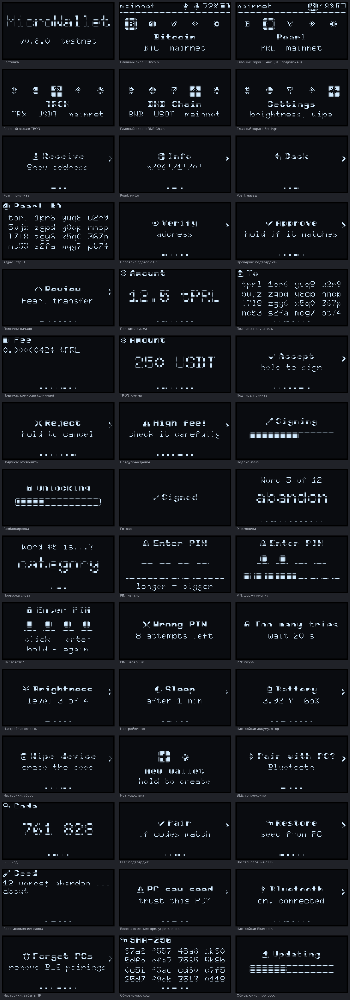
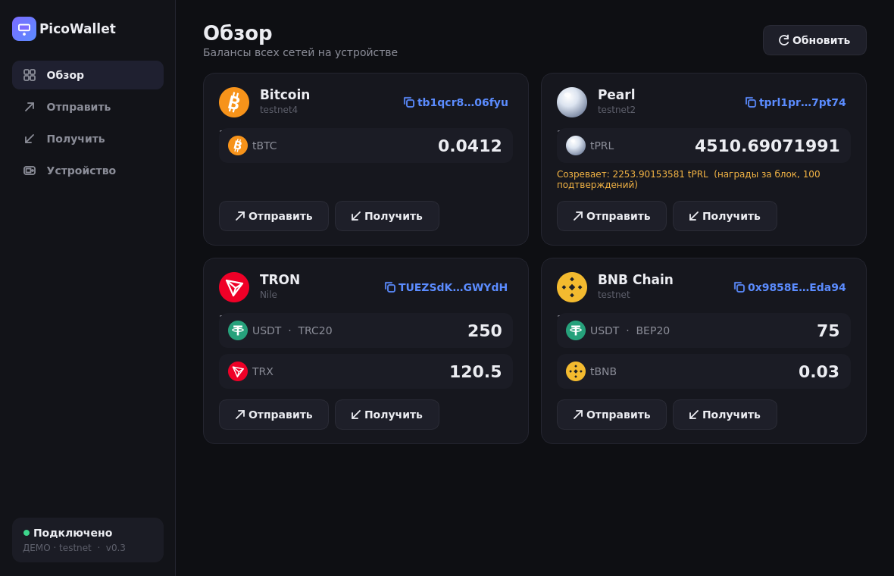
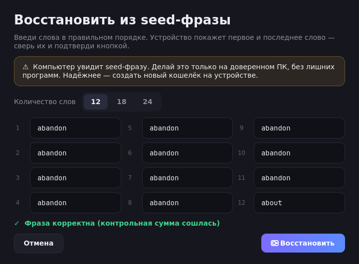

# MicroWallet v0.6 — учебный аппаратный кошелёк на ESP32-S3

Код открыт: https://github.com/delarun/MicroWallet · прошивки, приложения и APK —
в [релизах](https://github.com/delarun/MicroWallet/releases).

Монеты: **BTC**, **Pearl** (PRL), **TRON** (TRX и USDT-TRC20), **BNB Chain** (BNB и USDT-BEP20),
**Ethereum** (ETH, USDT, USDC). Все они выводятся из одной мнемоники (12, 18 или 24 слова).
В прошивке — только ключи, экраны и связь; каждая монета — приложение WebAssembly в
песочнице, которое ставится и обновляется отдельно (как приложения у Ledger).

| | ESP32-S3 SuperMini |
|---|---|
| Экран | SSD1306 128×64 |
| Кнопка | на GPIO1 (будит из выключения), встроенная BOOT тоже работает |
| Связь | USB и **Bluetooth LE** (свой шифрованный канал) |
| Приложения | Android, ПК (PySide6), консоль |
| ГСЧ для seed | **аппаратный TRNG** |
| Обновление прошивки | по USB или Bluetooth через протокол кошелька, с подтверждением на экране |
| Питание | USB или аккумулятор, **зарядка на плате** |
| Сон | экран гаснет через минуту (лёгкий сон), выключение через две |
| Защита seed | обычная сборка — открыто; **защищённая** — Secure Boot v2 + шифрование флеша и NVS |
| Экран | шрифт X11 6×10 (у g, q, y есть хвосты), адреса и хеши — группами по 4 символа |

> ⚠️ **По умолчанию прошивки собираются для testnet** (BTC testnet4, TRON Nile,
> BSC testnet, Pearl testnet2). В обычной сборке seed лежит в памяти в открытом виде:
> кто получил устройство в руки, тот получил монеты. Это учебный проект.
> Mainnet включается при сборке, и тогда держи на устройстве только мелкие суммы.

## Готовые прошивки

Файлы — в [релизах на GitHub](https://github.com/delarun/MicroWallet/releases) (при сборке
у себя они появляются в `esp32/dist` и `apps/dist`):

| Файл | Как ставить |
|---|---|
| `microwallet-esp32s3-{testnet,mainnet}-full.bin` | первый раз: `esptool.py --chip esp32s3 write_flash 0x0 …-full.bin` (уже со всеми приложениями) |
| `microwallet-esp32s3-{testnet,mainnet}-app.bin` | обновление: с телефона (Устройство → Обновить прошивку) или `python host/wallet.py update …-app.bin` |
| `microwallet-esp32s3-{testnet,mainnet}-secure-app.bin` | обновление платы с Secure Boot, подписано релизным ключом проекта (см. «Защищённая сборка») |
| `microwallet-esp32s3-apps.bin` | все приложения разом по USB: `esptool.py --chip esp32s3 write_flash 0x280000 …-apps.bin` |
| `microwallet-app-*.wasm` | приложения по одному: с телефона (Устройство → Приложения) или `wallet.py app-install` |
| `microwallet-android.apk` | приложение для Android |

Телефон по умолчанию сам берёт прошивки и приложения из релизов `delarun/MicroWallet`.

Seed и настройки при обновлении сохраняются (полный образ `-full.bin` начинает с чистого
листа). После смены сети (testnet ↔ mainnet) адреса BTC и Pearl другие, TRON, BSC и ETH — те же.

**Разметка флеша (4 МБ).** Два слота прошивки по 1.19 МБ (прошивка ~0.8 МБ) и 1.5 МБ под
приложения:

| Раздел | Адрес | Размер |
|---|---|---|
| nvs (seed, настройки, сопряжения) | 0x9000 | 24 КБ |
| otadata | 0xF000 | 8 КБ |
| ota_0 / ota_1 | 0x20000 / 0x150000 | 1216 КБ каждый |
| apps | 0x280000 | 1536 КБ |

**Переход с v0.5 и раньше** (монеты были встроены в прошивку, другая разметка). Адреса и подписи
у приложений те же самые — это проверяется тестом против эталонов прежней прошивки
(`tools/sim/golden.json`). Один раз по USB: таблица разделов, сброс выбора слота, прошивка в
первый слот и приложения. NVS (seed, настройки, сопряжения) не трогается:
```sh
D=esp32/dist
esptool.py --chip esp32s3 write_flash 0x8000 $D/microwallet-esp32s3-partitions.bin \
  0xF000 $D/microwallet-esp32s3-otadata.bin 0x20000 $D/microwallet-esp32s3-mainnet-app.bin \
  0x280000 $D/microwallet-esp32s3-apps.bin
```
Дальше прошивка и приложения обновляются по воздуху. Прошивка v0.6 работает и со старой
разметкой — просто без места под приложения.

## Железо

Экран — SSD1306 128×64, адрес 0x3C, питание 3V3 и GND. Если картинка перевёрнута, в
`src/oled.c` замени `0xA1, 0xC8` на `0xA0, 0xC0`. Пины меняются в `idf.py menuconfig` → MicroWallet.

| | ESP32-S3 SuperMini |
|---|---|
| SDA экрана | GPIO8 |
| SCL экрана | GPIO9 |
| Кнопка → GND | GPIO1 (+ BOOT на GPIO0) |
| Аккумулятор | площадки BAT+/BAT− снизу; напряжение — через делитель VBUS/2 на плате (GPIO3) |

Резистор к кнопке не нужен — включена внутренняя подтяжка. Экран работает на I2C 100 кГц:
на проводках этого надёжно хватает. Если провода длинные, поставь 4.7 кОм от SDA и SCL к 3V3.
Родной USB выведен на Type-C, логи ESP-IDF идут на UART0 (GPIO43/44) и протоколу не мешают.

Кнопка — на GPIO1, а не на BOOT: GPIO0 — пин выбора режима загрузки, и нажатая при
пробуждении или сбросе BOOT включает загрузчик ROM вместо кошелька.

### Аккумулятор

Зарядка уже на плате — аккумулятор паяется на площадки BAT+/BAT− снизу. Перемычка BOOST
поднимает ток заряда со 100 до 300 мА — только для аккумуляторов от 500 мА·ч; для
150–300 мА·ч её не трогай. Светодиоды питания лучше выпаять: в выключенном состоянии они
съедают почти весь ток.

Делитель паять не нужно: на плате уже стоят PR1/PR2 (100k/100k), они делят VBUS пополам и
заводят его на GPIO3. От USB там ~5 В — прошивка показывает зарядку (батарейка с молнией,
`chg=1` в `info`), напряжение аккумулятора в это время не измерить. От аккумулятора
VBUS = BAT − ~0.35 В на диоде (`MW_BATT_OFFSET_MV`). У делителя без конденсатора АЦП
занижает примерно в 0.8 раза, поэтому коэффициент — 2.5, а не 2 (`MW_BATT_DIVIDER_X100=250`,
откалибровано по мультиметру: 3.93 В на аккумуляторе и 5.0 В от USB).

Заряд показывается в строке статуса, в Settings → Battery и в приложениях.

**Питание от аккумулятора — впритык.** Путь BAT → диод BAT60B → VBUS → LDO ME6217 → 3V3, а на
входе LDO всего 1 мкФ. В пик тока (запуск радио, запись во флеш) линия 3.3 В проседает до
~2.9 В, поэтому детектор просадки стоит на заводских 2.44 В (с 2.84 В плата сбрасывалась уже
при старте). От зависания на почти пустом аккумуляторе защищают программные пороги: ниже
3.55 В не начинаются тяжёлые операции, ниже 3.45 В устройство выключается само. Мощность BLE —
0 дБм (рядом с телефоном хватает). Надёжнее всего — конденсатор 100–470 мкФ между VBUS и GND.
Если плата сбросилась, `boot=` в `info` скажет почему и на каком шаге: `brown@ble` — просадка
при запуске Bluetooth, `panic@run` — сбой во время работы.

### Сон и выключение

**Сон.** Через минуту простоя (Settings → Sleep: 30 с / 1 мин / 5 мин / никогда) гаснет
экран, и чип уходит в автоматический лёгкий сон: Bluetooth остаётся на связи (телефон
может подключиться — устройство проснётся), реклама BLE реже, кнопка будит сразу.
Пока к USB подключён компьютер, чип не спит.

**Выключение.** Settings → Power off (через 2 / 5 / 15 мин простоя или никогда; по
умолчанию 2 мин) и Turn off — выключить сейчас. Это глубокий сон, единицы-десятки
микроампер; будит кнопка на GPIO1, устройство загружается заново без заставки.
Пока подключён компьютер по USB или телефон по Bluetooth, само не выключается.

**Проверка экрана.** `python -c "import sys; sys.path.insert(0,'host'); import wallet as W; print(W.Device().call('oled'))"`
рисует тест (рамка, сплошной прямоугольник, шахматка); `… call('oled all')` зажигает
аппаратно все пиксели. Если и тогда видны тёмные строки через одну — повреждена сама панель.

## Управление и меню

Единственная кнопка:
- **короткое нажатие** — следующий экран (списки идут по кругу);
- **удержание 0.75 с** — выбрать (внизу экрана растёт полоска).

Главный экран — как у Ledger Nano X: все приложения одной строкой иконок 8×8, выбранное
на светлой плашке, под строкой название. Сверху строка статуса: сеть, значок Bluetooth
(на плашке — подключён телефон или ПК), значок USB и заряд аккумулятора.

```
[₿] (●) ▽ ◇ ◆ ⚙   Bitcoin ─ Pearl ─ TRON ─ BNB Chain ─ Ethereum ─ Settings   (главный экран)
   └─ Receive ─ About (версия, пути ключей) ─ Remove ─ Back        (внутри приложения)
         └─ адрес #0: нажатие — следующая страница, затем адрес #1…, удержание — назад
Settings: Brightness ─ Sleep ─ Power off ─ Addresses ─ Turn off ─ Battery ─ Bluetooth ─
          Forget PCs ─ MicroWallet ─ Wipe ─ Back
```

**Addresses** — сколько адресов для получения: 1, 5, 10 или 20 (по умолчанию 20). Столько
листает Receive и столько проверяют приложения для баланса BTC и Pearl. Больше 20 нельзя:
другие кошельки, восстанавливая seed, дальше 20 пустых адресов подряд не ищут. Если уже
получал на адрес с большим номером, не уменьшай — его баланс пропадёт из виду (монеты целы).

Адреса и хеши на экране — группами по 4 символа, как в приложении: сверять удобно группа
за группой. При холодном старте (не после пробуждения кнопкой) после заставки — защищён ли
seed: «Encrypted» (Secure Boot и шифрование включены) или «Not encrypted».

Всё, что требует решения, показывается по шагам с экранами **Accept** / **Reject**
(или Approve / Pair / Install / Restore): нажатие листает, удержание выбирает.
- подпись: Review → Amount → To → Fee → Accept → Reject (перед Fee — «High fee!», если комиссия подозрительная);
- адрес для приёма по запросу приложения — его надо подтвердить, иначе приложение получит отказ;
- сопряжение по Bluetooth — 6-значный код, тот же, что в приложении;
- восстановление из seed с телефона или ПК — первое и последнее слово;
- обновление прошивки — откуда (USB или Bluetooth), размер и SHA-256 образа.



Все экраны можно посмотреть без железа:
```sh
gcc -Isrc tools/oled_preview.c src/gfx.c src/ui.c src/icons.c -o preview
mkdir -p frames && ./preview frames && python3 tools/oled_preview.py frames screens.png
```

## Первый запуск

1. Экран «New wallet». Удерживай кнопку.
2. Устройство покажет 12 слов по одному. Запиши их на бумагу.
3. Проверка: для двух случайных слов по кругу показываются 3 варианта; на правильном держи кнопку.
4. Кошелёк сохранится, и откроется главное меню.

**Уже есть seed-фраза?** На пустом устройстве её можно ввести в приложении на телефоне или
ПК («Восстановить из seed-фразы») или `python host/wallet.py restore`. Устройство покажет
первое и последнее слово и запишет seed только после удержания на «Restore». Телефон или
компьютер при этом видит фразу — делай так только на доверенном.

## Приложение для Android

Kotlin + Jetpack Compose, `android/`. Связь — по Bluetooth через тот же шифрованный канал.

- **Обзор** — балансы всех сетей (у Pearl отдельно созревающие награды), обновление свайпом;
- **Получить** — QR-код, адреса по настройке устройства (Addresses), «Проверить на устройстве», «Поделиться»;
- **Отправить** — адрес вручную, из буфера или QR-сканером (понимает `bitcoin:…?amount=`),
  проверка адреса на лету, скорость или лимит комиссии, экран проверки, подпись на устройстве;
- **Устройство** — прошивка, сеть, заряд, защита, восстановление из seed-фразы (экран защищён от
  скриншотов), число адресов для получения, **обновление прошивки**, «Отключиться» / «Забыть устройство».

Баланс BTC и Pearl — это запросы к mempool.space и Blockbook по каждому адресу. Чтобы не
упираться в их лимиты (ответ 429): адреса сдачи проверяются подряд до первого пустого,
результат хранится 30 с, на 429 приложение ждёт (`Retry-After`) и повторяет.

При первом подключении сверь 6-значный код на экране устройства и в приложении. Если
свернуть приложение, через 2 минуты оно отключается, чтобы устройство могло уснуть.
Есть демо-режим без устройства.

**Обновление самого приложения.** При открытии (не чаще раза в 6 часов) приложение смотрит
релизы того же источника, что и прошивки (по умолчанию GitHub `delarun/MicroWallet`): рядом с
`microwallet-android.apk` там лежит `microwallet-android.json` с `versionCode` и SHA-256.
Новая версия скачивается, сверяется по SHA-256 и ставится через установщик Android — сама,
если телефон не подключён к устройству (установка перезапускает приложение), иначе — баннер
«Обновить». В первый раз Android спросит разрешение ставить приложения; дальше (Android 12+)
обновления идут без вопросов. Устройство → «Приложение»: версия, автообновление вкл/выкл,
«Проверить обновления». Подпись APK должна совпадать с установленной.

```sh
cd android
JAVA_HOME=/usr/lib/jvm/java-21-openjdk ./gradlew assembleRelease   # app/build/outputs/apk/release/
adb install -r app/build/outputs/apk/release/app-release.apk
MW_SIM=/путь/к/mwsim ./gradlew testDebugUnitTest                   # тесты на симуляторе устройства
```

Тесты прогоняют Kotlin-кошелёк через симулятор (тот же C-код, что в прошивке): транзакции
BTC, TRON и BSC совпадают байт в байт с `host/wallet.py` (эталоны — `app/src/test/gen_vectors.py`),
канал проверяется на сопряжении, повторном подключении, отказе кнопкой и подмене кадра.

### Обновление прошивки с телефона

Устройство → «Обновить прошивку»: по строке на сеть, версия выбирается в меню «Скачать»; установленная —
зелёным, если в релизах есть новее — «обновление до …» (так же и в каталоге приложений). Источник:
- **GitHub** (по умолчанию `delarun/MicroWallet`) — релизы репозитория `owner/repo`; в релизе
  нужен файл `microwallet-esp32s3-{testnet,mainnet}-app.bin`, для платы с Secure Boot —
  `…-secure-app.bin` (приложение берёт тот, что подходит устройству);
- **ПК** — для тестов: `python3 tools/fw_server.py` отдаёт `esp32/dist` в том же формате,
  телефон по USB видит его через `adb reverse tcp:8777 tcp:8777` по адресу `http://localhost:8777`;
- **Файл** — любой `*-app.bin` на телефоне.

Приложение проверяет, что это образ MicroWallet для этой платы, показывает версию, дату
сборки и SHA-256. Устройство показывает размер и тот же SHA-256 и ставит прошивку только
после удержания на «Install». Передача по Bluetooth занимает пару минут; после неё
устройство перезагружается, приложение переподключается само. Новая прошивка считается
годной, когда проработала 30 секунд: упадёт раньше — загрузчик вернёт предыдущую. `build=` в `info` — начало
SHA-256 ELF; по нему приложение видит, что эта сборка уже стоит.

## Приложения (WebAssembly)

Все монеты — приложения, которые ставятся на устройство отдельно, как у Ledger:

| Приложение | Что умеет |
|---|---|
| `btc` (`apps/utxo`) | BIP84 P2WPKH, BIP143; выводы P2WPKH/P2WSH/P2TR, проверка сдачи, xpub |
| `prl` (`apps/utxo`) | Pearl: BIP86 Taproot, BIP341 + BIP340; выводы P2TR и P2MR |
| `tron` | TRX и USDT-TRC20: устройство само разбирает protobuf транзакции ноды |
| `bsc` | BNB и USDT-BEP20, legacy EIP-155 |
| `eth` | ETH, USDT, USDC (Sepolia: USDC), legacy EIP-155, адреса как в MetaMask |

**Почему WebAssembly.** У ESP32 нет аппаратной изоляции, как у secure element в Ledger, поэтому
изоляцию даёт песочница: модуль видит только свою память (64 КБ), а ключи, экран и кнопку —
только через функции прошивки (`sdk/mw.h`). Прошивка проверяет каждое обращение:
- ключи выводятся только по путям из манифеста (`path=44'/60'`) — чужие ветки и seed недоступны;
- подписать можно только после того, как человек удержал «Accept» на экране проверки в этом
  же вызове — тихих подписей нет;
- выход за память или аварийная остановка (trap) — модуль останавливается, прошивка живёт дальше;
- на один вызов — не больше 50 млн инструкций WebAssembly: вечный цикл останавливается
  («App stopped / took too long»), а не вешает устройство. Ожидание кнопки и подписи в прошивке
  в счёт не идут; самая тяжёлая команда (подпись Pearl на 16 входов) — около 2.6 млн;
- перед каждым запуском проверяется SHA-256 модуля во флеше.

Ключи, хеши и подписи считает прошивка — приложение их только просит; разбор транзакций,
адреса и экраны проверки — в приложении. Что есть в прошивке (`sdk/mw.h`):

| Кривая / функция | Для чего | Ключи |
|---|---|---|
| secp256k1 ECDSA, xpub | BTC, EVM-сети, TRON | BIP32 по `path=` |
| BIP340 / Taproot (BIP86) | Pearl, Bitcoin Taproot | BIP32 по `path=` |
| **ed25519** | Solana, TON, Stellar, Aptos, Sui… | SLIP-10 по `path=`, все уровни hardened |
| **sr25519** (schnorrkel) | Polkadot, Kusama и другие Substrate-сети | как в Substrate: корень от энтропии фразы, `//hard` и `/soft`; нужно `sr25519=yes` в манифесте |
| sha256, keccak256, blake2b, hash160 | хеши | — |

Проверено по эталонам: адрес Solana для «abandon … about» — `HAgk14JpMQ…` (как в Phantom),
sr25519 dev-фразы Substrate — корень, `//Alice`, `/foo`, подписи сверяются независимо
(`tools/sim/test_curves.py`). sr25519 — библиотека sr25519-donna (Apache-2.0).

Движок — WAMR (интерпретатор, ~90 КБ прошивки), модуль — WebAssembly 1.0 без расширений,
пишется на C (или Rust/Zig). Установка: телефон или `wallet.py app-install`; устройство показывает
имя, версию, пути ключей и SHA-256 и ставит только после удержания кнопки. Удаление не трогает
seed: поставишь снова — адреса те же.

Приложения хранятся без фиксированных слотов: подряд, каждое с границы сектора 4 КБ (монеты
занимают 8–16 КБ, все пять — 64 КБ из 1536). Модуль — до 63.5 КБ, приложений — до 64.
Обновление сначала пишет новую копию, потом стирает старую: если питание пропадёт посередине,
при старте останется новая (у копий есть номер поколения). Перед каждым запуском проверяется
SHA-256 модуля.

```sh
sh apps/build.sh                       # все приложения -> apps/dist/microwallet-app-<id>-<версия>.wasm
sh sdk/build.sh apps/eth/eth.c out.wasm   # одно (нужен clang с целью wasm32 и wasm-ld)
python3 host/wallet.py apps            # что установлено
python3 host/wallet.py app-install apps/dist/microwallet-app-eth-1.0.wasm
python3 host/wallet.py app eth addr 0  # команда приложению
python3 host/wallet.py addrs 5         # сколько адресов для получения (1, 5, 10, 20)
python3 tools/sim/test_apps.py mwsim   # тесты: установка, подписи, песочница
python3 tools/sim/test_golden.py mwsim mwsim-mainnet   # монеты = прежняя прошивка, байт в байт
python3 tools/sim/test_curves.py mwsim # ed25519 и sr25519 по эталонам
python3 tools/sim/test_store.py mwsim  # хранилище: дыры, заполнение, сбой посреди обновления
```

Приложение — папка `apps/<id>/` с `<id>.c` (функция `mw_main`) и `manifest`:
```
id=eth                 2..8 символов a-z0-9, команды "app eth ..."
name=Ethereum
version=1.0
icon=183c7e3c5a3c1800  иконка 8×8 для строки на главном экране
path=44'/60'           разрешённые пути ключей secp256k1 и ed25519 (до 4)
sr25519=yes            доступ к ключам sr25519 (если нужен)
```
На устройстве приложения встают в строку иконок: Receive (адрес считает само приложение —
команда `addr <i>`), About, Remove.

**Раздел для приложений** — `apps` (1.5 МБ). Плате, прошитой раньше, его нужно один раз
добавить по USB — см. «Переход с v0.5» выше. Без раздела прошивка работает, но монет нет
(`apps=0` в `info`; `apps_free` — свободно, КБ).

## Приложение для ПК

```sh
pip install -r host/requirements.txt   # pyserial, PySide6, qrcode, cryptography, bleak
python host/app.py                     # с устройством (USB подключается само)
python host/app.py --ble auto          # по Bluetooth
python host/app.py --demo              # посмотреть интерфейс без устройства
```



То же, что на телефоне: Обзор, Отправить, Получить, Устройство (связь, журнал, USB /
**Bluetooth…** / **Обновить прошивку…** / режим загрузчика / стереть).



Ключей у приложений нет: подписывает только устройство. На Linux нужен доступ к
`/dev/ttyACM*` (группа `uucp` или `dialout`), для Bluetooth — работающий BlueZ.

### Bluetooth

1. Bluetooth на устройстве включён по умолчанию (Settings → Bluetooth).
2. Выбрать в приложении MicroWallet-XXXX.
3. Первый раз приложение и экран покажут **один и тот же 6-значный код**. Совпадает —
   удерживай кнопку на «Pair». Не совпадает — «Reject»: кто-то вмешивается в связь.
4. Дальше этот телефон или ПК подключается без кода. Забыть все: Settings → Forget PCs.

Канал свой, поверх BLE (`src/channel.c`, `host/ble.py`, `android/…/ble/Channel.kt`):
X25519 → HKDF-SHA256 → ChaCha20-Poly1305 с отдельными ключами на каждое направление и
строго растущим счётчиком. Код сопряжения выводится из того же обмена ключами, поэтому
подменить устройство посередине незаметно нельзя; ключ сопряжения хранится на устройстве
(до 4 штук), на ПК — в `~/.config/microwallet/ble.json`, на телефоне — зашифрованным ключом
Android Keystore. Подмена или повтор кадра рвут сессию.

## Консольная программа

```sh
python host/wallet.py info                    # --ble auto — то же по Bluetooth
python host/wallet.py restore                 # seed-фраза в пустое устройство (ввод скрыт)
python host/wallet.py update esp32/dist/microwallet-esp32s3-testnet-app.bin
python host/wallet.py ble-scan

# BTC (старые команды без "btc" тоже работают)
python host/wallet.py btc receive            # адрес; подтверди на устройстве
python host/wallet.py btc balance
python host/wallet.py btc send tb1q... 10000 --feerate 2 --dry-run

# TRON: USDT-TRC20 (по умолчанию) или TRX
python host/wallet.py tron send T... 12.5                     # USDT
python host/wallet.py tron send T... 3 --token trx

# BSC: USDT-BEP20 (по умолчанию) или BNB
python host/wallet.py bsc send 0x... 12.5                     # USDT
python host/wallet.py bsc send 0x... 0.01 --token bnb --gas-price 1

# Pearl (суммы в PRL)
python host/wallet.py prl receive                             # prl1p...
python host/wallet.py prl balance                             # показывает и созревающие награды
python host/wallet.py prl send prl1p... 12.5 --feerate 2      # grain/vB, по умолчанию оценка сети
```

**PSBT — Sparrow, Electrum.** Устройство остаётся «подписывающим», кошелёк ведёт Sparrow:
```sh
python host/wallet.py btc descriptor          # wpkh([отпечаток/84h/1h/0h]tpub…/<0;1>/*)#…
#   Sparrow: File → New Wallet → Watch Only → Output Descriptor (вставить строку)
#   Electrum: Standard wallet → Use a master key → zpub/vpub из «btc xpub»
python host/wallet.py btc psbt-sign tx.psbt -o signed.psbt   # подписать PSBT из Sparrow
python host/wallet.py btc psbt-sign tx.psbt --broadcast      # и сразу собрать и отправить
```
То же — в приложении для ПК (Устройство → «Bitcoin: PSBT и Sparrow»: «Для Sparrow…», «Подписать PSBT…»)
и на телефоне (Устройство → карточка PSBT: дескриптор, PSBT из файла или буфера, «Подписать» или
«Подписать и отправить», затем «Поделиться» / «Скопировать» / «Сохранить файл»).

PSBT разбирает хост (`host/psbt.py`, `android/…/core/Psbt.kt`, BIP174 v0) и переводит в обычный запрос устройства — для
денег это не опаснее: получателей устройство показывает само, адрес сдачи (по `bip32_derivation`
выхода) выводит само, суммы входов проверяет по предыдущим транзакциям (`non_witness_utxo`
или скачивает), подписывает только SIGHASH_ALL. Только свои P2WPKH-входы m/84'/c'/0'/…;
мультиподписи и подписи без провода (SD/QR) пока нет. Отпечаток мастер-ключа — команда
`fingerprint`.

**Майнинг Pearl.** Возьми адрес из `prl receive` (сверь с экраном) и укажи его как адрес
выплат в пуле или в `pearld --miningaddr`. Pearl Wallet с теми же словами покажет те же
адреса (BIP86, `m/86'/808276'/0'`). Награда за блок доступна через 100 блоков, `prl balance`
показывает её отдельно. Устройство подписывает до 64 входов за раз.

`--dry-run` подписывает транзакцию, но не отправляет её. USDT-TRC20 тратит энергию,
которая оплачивается сжиганием TRX; новый TRON-адрес нужно активировать (1 TRX).
USDT-BEP20 платит газ в BNB. Данные по Pearl — из публичного Blockbook
(`blockbook.pearlresearch.ai`), для TronGrid можно задать `TRONGRID_API_KEY`.

## Сборка

```sh
./get_deps.sh                      # lib/: trezor-crypto, WAMR, sr25519-donna (зафиксированные версии)
. ~/esp/esp-idf/export.sh          # ESP-IDF 5.4+
cd esp32
idf.py build flash                                                          # testnet
idf.py -D SDKCONFIG_DEFAULTS="sdkconfig.defaults;sdkconfig.mainnet" build   # mainnet
sh ../apps/build.sh                # приложения (нужен clang с целью wasm32 и wasm-ld)
```
Уже прошитую плату дальше удобно обновлять без esptool: с телефона или
`python host/wallet.py update build/microwallet.bin`.

**Релиз** целиком — `tools/release.sh` (сборка в `build/release/`) или `tools/release.sh v0.7.0`
(ещё и публикация через `gh`, описание — `build/release-notes.md`): обычные прошивки,
защищённые с подписью релизным ключом (`MW_RELEASE_KEY`, по умолчанию
`~/microwallet-keys/release.pem`), приложения, `apps.bin`, APK с описанием версии и `SHA256SUMS`.

### Защищённая сборка

`sdkconfig.secure` включает Secure Boot v2 (RSA-3072), шифрование флеша и шифрование NVS,
где лежит seed. **Первая загрузка такой прошивки необратимо прожигает eFuse платы**: дальше
запустится только прошивка, подписанная одним из прожжённых ключей, флеш читается только
как шифротекст, JTAG выключен, seed зашифрован ключами, которых нет нигде, кроме самой платы.

**Ключи.** Слотов под ключи три, и при первой загрузке загрузчик прожигает хеши всех ключей,
которыми подписан он сам, а пустые слоты **отзывает навсегда** — набор ключей выбирается один
раз. Схема проекта:

| Ключ | Чем подписывается | Где хранить |
|---|---|---|
| личный (`esp32/secure_boot_signing_key.pem`) | свои сборки на этом ПК | на ПК + офлайн-копия |
| релизный | официальные релизы на GitHub (`*-secure-app.bin`) | только офлайн |
| резервный | ничего — на случай потери или утечки двух других | только офлайн |

Плата примет прошивку, подписанную любым из трёх — но с оговоркой ESP-IDF: загрузчик доверяет
ключу из слота eFuse №k, только если у образа есть блок подписи №k. Поэтому образ с релизным
ключом (слот 1) подписывается им дважды (блоки 0 и 1; `tools/release.sh` делает это сам), а
резервным (слот 2) — трижды. С одной подписью образ запишется и пройдёт проверку при
обновлении, но плата загрузит прежнюю прошивку (в `info` будет старый `build`). Утёкший ключ отзывается своим eFuse
(`SECURE_BOOT_KEY_REVOKEn`), остальные продолжают работать. Код открыт — безопасность держится
на закрытых ключах, а не на секретности кода; поставить прошивку на устройство всё равно можно
только удержанием кнопки на «Install». Ключи `*.pem` в репозиторий не попадают (`.gitignore`).
Потеряешь все три — плату больше не обновить никогда.

**Режим.** Сейчас — Development: ROM-загрузчик по USB остаётся и умеет писать флеш
зашифрованным, так что плату можно поднять даже со сломанной прошивкой
(`esptool.py write_flash --encrypt 0x20000 <подписанный -secure-app.bin>`). Release (закрыть
это, дожечь `SPI_BOOT_CRYPT_CNT`, включить безопасный режим загрузки) — отдельно через
espefuse, когда прошивка устоится.

```sh
cd esp32
espsecure.py generate_signing_key --version 2 --scheme rsa3072 secure_boot_signing_key.pem
espsecure.py generate_signing_key --version 2 --scheme rsa3072 ~/microwallet-keys/release.pem
espsecure.py generate_signing_key --version 2 --scheme rsa3072 ~/microwallet-keys/backup.pem
#  ↑ СДЕЛАЙ ОФЛАЙН-КОПИИ всех трёх. Релизный и резервный потом убери с ПК.
idf.py -D SDKCONFIG_DEFAULTS="sdkconfig.defaults;sdkconfig.mainnet;sdkconfig.secure" build
# загрузчик — подписью всех трёх ключей (их хеши и прожгутся):
espsecure.py sign_data --version 2 --append_signatures --keyfile ~/microwallet-keys/release.pem \
  ~/microwallet-keys/backup.pem -o bootloader-3keys.bin build/bootloader/bootloader.bin
# первая прошивка — на USB-питании; дальше начинается необратимое:
esptool.py --chip esp32s3 write_flash -e --flash_mode keep --flash_freq keep --flash_size keep \
  0x0 bootloader-3keys.bin 0xD000 build/partition_table/partition-table.bin \
  0x15000 build/ota_data_initial.bin 0x20000 build/microwallet.bin 0x280000 dist/microwallet-esp32s3-apps.bin
```
Первая загрузка (секунд десять) генерирует в плате ключ шифрования, шифрует флеш и прожигает
eFuse; затем `info` показывает `secure=1`, а экран при старте — «Encrypted». Seed на плате
после этого пустой: восстанови его из фразы. Таблица разделов у защищённой сборки другая
(начинается с 0xD000, есть `nvs_keys`), поэтому обновляется она только `…-secure-app.bin`.

### Тесты на ПК

Монеты проверяются через симулятор с теми же приложениями, что на устройстве:
`tools/sim/test_golden.py` (адреса, xpub, подписи против прежней прошивки, BIP340 для Pearl),
`tools/sim/test_apps.py` (Ethereum и песочница), тесты Android (`MW_SIM=… ./gradlew test`).

Симулятор устройства — то же ядро на ПК, хранилище в файлах, подтверждения
отвечаются автоматически (`MW_SIM_ANSWER=reject` — отказ):
```sh
tools/sim/build.sh mwsim
echo info | MW_SIM_DIR=/tmp ./mwsim lines      # построчно, как по USB
./mwsim frames                                 # кадры шифрованного канала, как по BLE
```
`host/ble.py` (`SimTransport`) и тесты Android-приложения говорят с ним без радио.

## Как это устроено

```
src/            ядро: app.c (команды и экраны), menu.c, ux.c, ui.c, wallet.c (ключи BIP32,
                SLIP-10 ed25519, sr25519), schnorr.c (BIP340/Taproot), channel.c (BLE-канал), hal.h
src/apps.c      приложения WebAssembly: хранение, установка, запуск, API (модуль "mw")
sdk/            SDK приложений: mw.h, mw.c (SHA-256, bech32, base58), build.sh, pack.py
apps/           монеты: utxo (btc, prl), tron, bsc, eth; apps/build.sh -> apps/dist
esp32/main/     ESP32-S3: main.c (очередь, сон), hal_esp.c (TRNG, I2C, кнопка, АЦП), storage_esp.c (NVS),
                ble.c (NimBLE), ota.c (обновление по USB и BLE)
tools/sim/      ядро на ПК для тестов; tools/fw_server.py — прошивки с ПК для телефона
host/           wallet.py (библиотека и консоль), ble.py (BLE-канал), app.py (приложение для ПК)
android/        приложение для Android: core/ (кошелёк, сети, прошивка), ble/ (канал, GATT), ui/
```

| Монета | Путь | Адрес | Что подписывается |
|---|---|---|---|
| BTC | `m/84'/1'/0'/{0,1}/i` (mainnet `84'/0'`) | P2WPKH `tb1q…` | BIP143, только свои P2WPKH-входы; выводы P2WPKH/P2WSH/P2TR |
| TRON | `m/44'/195'/0'/0/i` | `T…` (как в TronLink) | `sha256(raw_data)`: TransferContract (TRX) или `transfer()` USDT |
| BSC | `m/44'/60'/0'/0/i` | `0x…` EIP-55 (как в MetaMask) | `keccak256` от legacy-транзакции EIP-155: перевод BNB или `transfer()` USDT |
| PRL | `m/86'/808276'/0'/{0,1}/i` (testnet `86'/1'`) | Taproot `prl1p…` (как в Pearl Wallet) | BIP341 key-path, подпись Schnorr BIP340; выводы P2TR и P2MR |

Что проверяет устройство:
- **BTC.** Хост не может тайно подменить получателя (он виден на экране), сдачу
  (устройство выводит её адрес само) или суммы входов: к запросу хост прикладывает
  предыдущие транзакции целиком, приложение само считает их txid и берёт суммы оттуда —
  атака «соврать о сумме входа» (BIP143 подписывает сумму только своего входа) не проходит.
  До 64 входов и 16 получателей; запрос уходит блоком (`sign @`).
- **TRON.** Транзакцию собирает нода, устройство само разбирает protobuf: отправитель —
  этот кошелёк, ровно один контракт, неизвестные и повторяющиеся поля — отказ.
- **BSC, Ethereum** (общий код `apps/evm/evm.c`). chainId — по сети сборки. Транзакции legacy EIP-155
  и EIP-1559 (тип 2, пустой access list; ETH с телефона — тип 2: maxFee = 2 × baseFee + чаевые), RLP
  только каноничный. Только перевод монеты или `transfer()` токена из белого списка; `approve` и другие
  вызовы контрактов отклоняются. На экране — сумма, получатель, максимальная комиссия, **nonce** и
  сеть; «High fee!» выше 0.005 BNB/ETH.
- **Pearl.** Только Taproot; подпись BIP341 покрывает суммы и скрипты всех входов, так что
  «хост соврал о сумме входа» для Pearl не работает.
- Белые списки токенов — в самих приложениях (`apps/tron`, `apps/bsc`, `apps/eth`).

Протокол (строки по USB или внутри BLE-канала). `show`, `sign`, `wipe`, `restore` ждут
подтверждения на устройстве, отказ — `err rejected`:
`ping`, `info`, `wipe`, `boot`, `restore <entropy hex>`;
BTC: `app btc xpub`, `app btc addr|show <chain> <i>`, `app btc sign @` (запрос и предыдущие транзакции блоком; формат — в начале `apps/utxo/utxo.c`);
PRL: `app prl addr|show <chain> <i>`, `app prl sign @` (или `sign <hex>`, если запрос влезает в строку);
TRON: `app tron addr|show <i>`, `app tron sign <i> <raw_data hex>`;
BSC и ETH: `app bsc|eth addr|show <i>`, `app bsc|eth sign <i> <rlp hex>`;
прошивка: `ota begin <size> <sha256>` (или `ota zbegin …` — дальше сжатый zlib-поток, на ~40% меньше данных),
`ota b64 <base64, до 2048 байт>` (или `ota data <hex>`), `ota end`, `ota abort`; хосты шлют куски конвейером
(до 4 без ожидания ответа);
приложения: `apps`, `app add <size> <sha256>` / `app add b64 <…>` / `app add end`, `app rm <id>`, `app <id> <команда>`;
большие данные: `app put <size> <sha256>` / `app put b64 <…>` / `app put end` — блок до 512 КБ для следующей
команды, которая кончается на ` @` (приложение читает его `mw_blob_read`); ответ длиннее строки приходит как
`ok @<size> <sha256>` и забирается `app get <offset>` (хелперы: `wallet.app_call`, Android `Device.appCall`).
`addrs <1|5|10|20>` — сколько адресов для получения; `apps order <id>,<id>,…` — порядок приложений на главном экране
(в приложении для телефона — стрелки в «Приложения → На устройстве»).
`info`: `fw`, `net`, `state`, `coins` (установленные приложения), `hw=esp32s3`, `batt` (мВ), `chg`, `build`, `boot` (причина запуска, после сбоя — с шагом: `brown@ble`), `heap`, `apps` и `apps_free` (КБ), `addrs`, `secure` (Secure Boot и шифрование включены), `ota` (`ota_0/valid`: рабочий слот и состояние другого; `aborted` —
новая прошивка не прижилась, загрузчик откатил).
Хосты понимают и прошивки до v0.6 со встроенными монетами (команды без `app <id>`).

## Известные слабые места

1. **Seed в открытом виде** в обычной сборке (экран при старте так и пишет: «Not encrypted»).
   Это решает защищённая сборка; в режиме Development по USB ещё можно записать подписанную
   прошивку, полная защита — после перевода в Release.
2. **Ввод seed на телефоне или ПК** удобен, но устройство ввода видит фразу. Ввода на самом
   устройстве одной кнопкой пока нет.
3. TRON: на экране `fee_limit`, но не реальная цена энергии; нет мемо и TRC10.
4. EVM: nonce и цену газа сообщает хост (устройство их показывает, но проверить не может); BSC с телефона пока
   уходит legacy-транзакцией (тип 2 устройство подписывает, приём сетью BSC не проверен).
5. Pearl: только key-path Taproot; своих P2MR/XMSS-ключей нет.

## Лицензия

[Apache License 2.0](LICENSE). Сторонние библиотеки (скачиваются в `lib/` через `get_deps.sh`)
идут под своими лицензиями: trezor-crypto — MIT, WAMR — Apache-2.0 WITH LLVM-exception,
sr25519-donna — Apache-2.0. Шрифт X11 misc-fixed 6×10 — общественное достояние.
